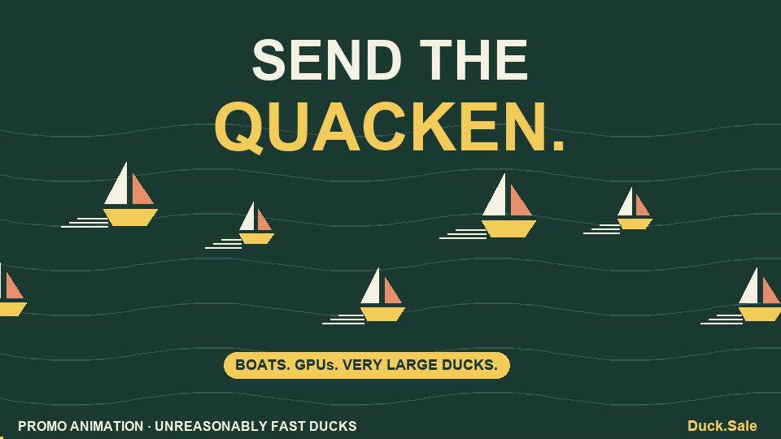
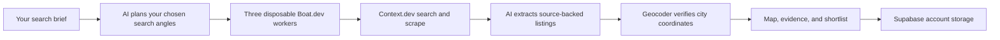
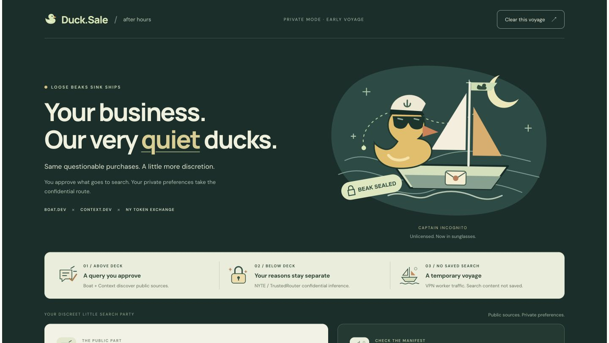

<div align="center">

# 🦆 Duck.Sale

### Find your next questionable purchase. Privately, if necessary.

A fleet of little search boats. Real source links. A suspiciously large duck budget.

**[Try it live](https://duck.sale)** · **[Install & run locally](#install-and-run-locally)** · **[Watch the 3-minute demo](https://youtu.be/XXRGiBiYMJ0)** · **[Open Private Mode](https://duck.sale/private)** · **[Download the deck](https://duck.sale/demo/duck-sale-deck.pptx)**

🖥️ **[Build a PC](https://duck.sale/pc)** — a bonus eight-part PC planner. NY Token Exchange proposes models and extracts quoted specifications; Context.dev reads manufacturer pages; code runs 18 compatibility checks for sockets, memory, fit, storage and power. Concrete conflicts can trigger one bounded parts correction. Missing evidence and BIOS/assembly checks stay explicit. Budget allocations are targets, not live prices. Save the build, download the list, or send any part to the full fleet. [How PC mode works](docs/PC-MODE.md).

🍕 **[Feed the crew](https://duck.sale/food)** — a DoorDash food and retail scout. Main searches can also launch **Dash Duck**, a fourth scout for plausible retail items, alternatives or accessories. Pick a city, find restaurants, groceries or retail items, then browse and order yourself on DoorDash. Search only: no carts, payments, orders, or personal account data are exposed. [Optional setup and token renewal](docs/DOORDASH.md).




</div>

## Ahoy, treasure hunters 🏴‍☠️

Looking for a sailboat? A GPU with more memory than your first computer? A giant inflatable duck that absolutely counts as a sensible purchase?

**Tell Duck.Sale what you want. Send the ducks. Follow the treasure.** A fleet of AI-powered search boats heads out across the web and brings back prices, photos, locations, and links to the original listings. Watch the boats work, inspect their receipts, and save the good finds.

### Pick your first voyage

| Try it live | Install it yourself |
|---|---|
| Open **[duck.sale](https://duck.sale)**, sign in, and describe your treasure. We run the services. | Clone this repo and follow the **[installation guide below](#install-and-run-locally)**. Explore the local app first, then connect your own services for fresh searches. |
| Want a quick look first? Click **Watch 20-boat voyage** for a recorded tour with no sign-in. | **Node.js 22+, Git, and four commands** get the app running. No API keys are needed for the recorded tour. |

Boats, GPUs and AI computers, Pokémon boxes, giant rubber ducks—or type your own hunt. For surprise gifts and private preferences, there’s also **[Private Mode](#private-mode-plainly-explained)**. The duck can keep a birthday plan out of the public search query.

> **Real treasure, honest receipts.** Fresh searches make real provider calls and may return partial results. The recorded tour uses source snapshots and simulated travel, clearly labeled. Missing facts stay unknown, and AI-generated pictures are labeled illustrations.

## Install and run locally

### 1. Get your supplies

Install **[Node.js 22 or newer](https://nodejs.org/en/download)** (includes npm) and **[Git](https://git-scm.com/downloads)**. Check they’re available in your terminal:

```bash
node --version
npm --version
git --version
```

### 2. Launch the app

Run these four commands, one line at a time:

```bash
git clone https://github.com/jacobwell/Duck.Sale.git
cd Duck.Sale
npm ci
npm run dev
```

### 3. Open your harbor

Visit **[http://localhost:3000](http://localhost:3000)**. Keep that terminal open while you use the app; press **Ctrl+C** in that terminal when you’re finished.

Click **Watch 20-boat voyage** to explore the map, boats, and listing snapshots. This first run needs no `.env` file or API keys. The tour is a recorded replay; fresh searches, sign-in, and saved finds become available when you connect the services below.

### 4. Send a fresh search

Choose how you want to power your searches:

- **Your own app and keys:** follow [self-host live searches](#self-host-live-searches) to connect Supabase, Boat.dev, Context.dev, and either OpenAI or Vercel AI Gateway.
- **Our backend from your terminal:** follow [hosted access](#use-our-hosted-backend) to use one temporary token instead of setting up provider accounts.
- **Ready to sail right now:** the hosted app at [duck.sale](https://duck.sale) is available too.

If port 3000 is already occupied, use the existing Duck.Sale server or free that port before running the command. You only need one local server.

## Find your way around

- [Install and run locally](#install-and-run-locally)
- [Choose your setup](#choose-your-setup)
- [Self-host live searches](#self-host-live-searches)
- [Use our hosted backend](#use-our-hosted-backend)
- [Requirements and environment variables](#requirements-and-environment-variables)
- [Deploy your own copy](#deploy-your-own-copy)
- [Troubleshooting](#troubleshooting)
- [Why this build stands out](#why-this-build-stands-out)
- [How the boats work](#how-the-boats-work)
- [What each tool actually does](#what-each-tool-actually-does)
- [Private Mode, plainly explained](#private-mode-plainly-explained)
- [What works, what is limited](#what-works-what-is-limited)
- [A 60-second judge walkthrough](#a-60-second-judge-walkthrough)
- [Code map and verification](#code-map-and-verification)

## Why this build stands out

1. **Useful beyond the boat joke.** One brief searches across sources and categories, with specialist and local search angles.
2. **You can inspect the work.** Select a boat to see its actual provider calls. Open a listing to inspect source evidence. Errors and partial coverage remain visible.
3. **Privacy has a concrete data flow.** Private Mode uses NYTE to draft a public query from your private brief, asks for your approval, then confidentially extracts and ranks the discoveries. It verifies the confidential gateway connection and checks worker VPN egress.
4. **The interface teaches the system.** Boats, routes, treasure pins, and the radio panel explain parallel discovery without hiding uncertainty.
5. **The ducks have brakes.** Bounded worker lifetimes, transactional admission limits, a shared Context request queue, and explicit cleanup help contain spending and failures.

Built for the Boat hackathon with AI-agent assistance under human direction. Curious about the challenge? See the [hackathon requirements and evidence](docs/HACKATHON.md).

## How the boats work



The AI can suggest a location interpretation, but a geocoder supplies the displayed coordinates. Source evidence is checked before retaining prices, availability statements, images, and attributes. Listings are leads—not independent seller verification.

## What each tool actually does

| Tool | Actual integration | Where to inspect it |
|---|---|---|
| **Boat.dev** | Creates isolated search sandboxes, executes a fixed worker program, and stops/deletes workers | [Worker lifecycle](lib/server/boat.ts) |
| **Context.dev** | Searches the web and reads source pages inside the workers | [Worker program](lib/server/worker-source.ts) |
| **Vercel AI Gateway** | Standard-mode planning, structured extraction, location normalization, optional image generation | [AI pipeline](lib/server/ai.ts), [illustrations](lib/server/illustrations.ts) |
| **OpenAI directly** | Optional alternative to Gateway for standard-mode text and images, using your OpenAI key | [Model selection](lib/server/models.ts) |
| **NY Token Exchange / TrustedRouter** | Private query preparation, source-fact extraction, and personalized ranking, with confidential-only routing, gateway attestation, and TLS binding checks | [Private inference](lib/server/private/inference.ts), [transport](lib/server/private/transport.ts) |
| **Mullvad / WireGuard** | Private workers use an isolated network namespace and a checked VPN exit; no direct-network fallback | [VPN launcher](lib/server/private/vpn-source.ts) |
| **Supabase** | Login, account-isolated standard searches and saved finds, generation records, and admission limits | [Migrations](supabase/migrations), [server auth](lib/server/db.ts) |
| **Next.js + Vercel** | UI, server routes, streaming updates, hosting, and environment configuration | [App](app), [deployment config](vercel.json) |
| **Open-Meteo / GeoNames** | City-level coordinates, not guessed seller addresses | [Geocoding](lib/server/geocode.ts) |
| **Teamily** | Hackathon coordination/source of event requirements; no Teamily API integration claimed | [Event notes](docs/HACKATHON.md) |

## Private Mode, plainly explained



Imagine buying a surprise giant duck. The internet needs to know **“giant inflatable duck for sale.”** It does not need the birthday plan or your real budget.

1. **Start with your private brief.** NYTE can propose a minimal public query while omitting budgets, names, and personal reasons. The app handles the brief in server memory; preparation makes no Boat or Context calls.
2. **Review, edit, and approve the public query.** AI can miss sensitive details. Only the exact terms you approve go to Boat/Context when you click **Send the secret duck**. You can also skip preparation and write the query yourself.
3. **The worker uses a VPN.** Its exit is checked before discovery. NYTE then extracts source-backed prices, locations, and availability and ranks results against your original private brief. Unsupported facts remain unknown. If confidential inference or the required VPN is unavailable, the request stops without an ordinary fallback.
4. **Follow the live voyage bridge.** Watch the animated boat, actual stage changes, elapsed time, source counts, and a privacy-safe API radio with HTTP statuses and durations. Heartbeats keep the connection visible while providers work. Query preparation and the final voyage include verification receipts; the activity feed stays only in page memory.

**What is not saved:** the private brief, proposed query, approved query, retrieved content, and results are not written to Duck.Sale’s search history. **What remains:** account/timing metadata for admission and rate limits. The browser clears page content on departure or after 15 minutes.

**Honest boundary:** this is not zero trace or browser-to-enclave encryption. The hosted app sees the brief in memory; providers receive the approved public query and requested pages; infrastructure metadata may remain. Context’s remote crawlers do not inherit the worker VPN. Photos do not load automatically in Private Mode. [Full privacy design and dated verification](docs/PRIVATE-MODE.md).

## Choose your setup

| You want to… | Provider keys needed? | Database needed? | Start here |
|---|---|---|---|
| Explore the hosted replay and UI | No | No | [duck.sale](https://duck.sale) |
| Run the UI and recorded replay locally | No | No | [Local installation](#install-and-run-locally) |
| Ask our backend to do a fresh search | No provider keys; one temporary access token | No local database | [Hosted access](#use-our-hosted-backend) |
| Run your own live-search installation | Boat + Context + Gateway **or** OpenAI | Your own Supabase project | [Self-hosting](#self-host-live-searches) |
| Self-host Private Mode | Above, plus TrustedRouter and WireGuard | Your own Supabase project | [Self-hosting](#self-host-live-searches) + [private setup](docs/PRIVATE-MODE.md) |

**An OpenAI key replaces the standard AI provider, not Boat, Context, or Supabase.** It does not turn ordinary OpenAI inference into confidential inference.

## Use our hosted backend

This is the **API/terminal path**: your local client calls our server, and our server manages the provider calls. For the full UI, use [duck.sale](https://duck.sale).

Ask the maintainer for a temporary `client.env` file, then save it as **`.env.hosted.local`** in this checkout. It contains:

```dotenv
DUCK_SALE_BACKEND_URL=https://duck.sale
DUCK_SALE_HOSTED_TOKEN=PASTE_THE_ISSUED_TOKEN_HERE
```

Check access without spending search credits:

```bash
npm run search:hosted -- --check
```

Run a fresh search:

```bash
npm run search:hosted -- "Catalina 30 sailboat for sale California"
```

The command streams real search events as newline-delimited JSON as the boats work. A fresh voyage can take a few minutes; the same provider quotas and search limits apply as on the website.

**No provider keys are shared. No arbitrary token is accepted.** The issued token is random, expires, and only grants the dedicated demo search endpoints. It cannot read history or saved finds. Keep it out of screenshots, commits, and public README files. [Hosted/private API examples, issuance, limits, and revocation](docs/HOSTED-ACCESS.md).

## Self-host live searches

### 1. Install and copy the example

After [installing the app](#install-and-run-locally), open another terminal in the `Duck.Sale` folder and run:

```bash
cp .env.example .env.local
```

Fill `.env.local` locally. Never commit it. Do not put server secrets in variables beginning `NEXT_PUBLIC_`.

### 2. Create your own Supabase project

Copy its project URL and public anon/publishable key into the two `NEXT_PUBLIC_SUPABASE_*` variables. Put the service-role/secret key in `SUPABASE_SERVICE_ROLE_KEY` **on the server only**. Set `POSTGRES_URL_NON_POOLING` to your project’s direct or session-pooler PostgreSQL connection string for migrations.

```bash
node --env-file=.env.local scripts/migrate.mjs
```

The runner verifies database TLS, tracks completed migrations, and applies changes in a transaction. If the connection fails, confirm your credentials and connection mode; do not disable certificate checking.

In **Supabase → Authentication → URL Configuration**, set your Site URL and allow:

- `http://localhost:3000/**` for local development
- `https://YOUR-DOMAIN/**` for your deployment

Enable email login. Supabase’s default email service has recipient restrictions; configure SMTP for general public signups. The original hosted project can be opened through **Vercel → Storage → Supabase → Open in Supabase**; a fork should use its own project.

### 3. Add Boat and Context keys

Set `BOAT_API_KEY` and `CONTEXT_DEV_API_KEY`. These must belong to accounts with working access/credits. Local workers also need a publicly reachable permit endpoint: set `DUCK_SALE_APP_URL` to **your own deployed copy** with the same database and server key. Do not point a separately configured database at our production permit endpoint.

### 4. Pick one standard AI provider

**Option 1 — Vercel AI Gateway (default):**

```dotenv
AI_PROVIDER=gateway
AI_GATEWAY_API_KEY=YOUR_GATEWAY_KEY
```

On Vercel, project OIDC can supply Gateway authentication instead. For local runs, a Gateway API key is the simplest setup.

**Option 2 — Your OpenAI key, called directly:**

```dotenv
AI_PROVIDER=openai
OPENAI_API_KEY=YOUR_OPENAI_KEY
OPENAI_MODEL=gpt-6.2-sol
OPENAI_IMAGE_MODEL=gpt-image-2.6-flare
```

Choose models available to your account. Text models must support structured output. The radio and service setup panel identify **OpenAI** when that route is selected; private inference still uses NYTE. Image generation is optional and billed separately.

### 5. Load your configuration

If the app is still running from the quickstart, press **Ctrl+C in its terminal**, then start it again to load your new environment variables:

```bash
npm run dev
```

Open localhost:3000 → **Service setup** → check that services are configured → sign in → send a small search. “Configured” means credentials are present, not that provider credits or every request have been verified.

For Private Mode, also configure `TRUSTEDROUTER_API_KEY` and `DUCK_SALE_PRIVATE_VPN_JSON`. The latter is a complete dedicated WireGuard profile—not a VPN subscription name. [Required profile fields and privacy behavior](docs/PRIVATE-MODE.md).

## Requirements and environment variables

Blank values and comments are in [`.env.example`](.env.example).

| Variable | Needed for | Secret? |
|---|---|---|
| `BOAT_API_KEY` | Live worker creation | Yes |
| `CONTEXT_DEV_API_KEY` | Live web search/scraping | Yes |
| `NEXT_PUBLIC_SUPABASE_URL` | Login and account storage | No |
| `NEXT_PUBLIC_SUPABASE_ANON_KEY` | Public Supabase client, protected by RLS | No; never substitute the service key |
| `SUPABASE_SERVICE_ROLE_KEY` | Server-side storage and admission | **Yes, server only** |
| `POSTGRES_URL_NON_POOLING` | Apply migrations | **Yes** |
| `AI_PROVIDER` | `gateway` (default) or `openai` | No |
| `AI_GATEWAY_API_KEY` | Gateway outside Vercel OIDC | Yes |
| `OPENAI_API_KEY` | Direct OpenAI mode | Yes |
| `OPENAI_MODEL` / `OPENAI_IMAGE_MODEL` | Direct OpenAI model overrides | No |
| `AI_MODEL` / `AI_IMAGE_MODEL` | Gateway model overrides | No |
| `DUCK_SALE_APP_URL` | Public origin for your workers’ permit callback | No |
| `TRUSTEDROUTER_API_KEY` | Private Mode confidential inference | Yes |
| `DUCK_SALE_PRIVATE_VPN_JSON` | Private Mode WireGuard profile | **Yes: includes a private key** |
| `DUCK_SALE_VISION` | Optional source-photo analysis; default `false` | No |
| `OPEN_METEO_API_KEY` | Licensed commercial geocoding, when applicable | Yes |
| `DUCK_SALE_BACKEND_URL` / `DUCK_SALE_HOSTED_TOKEN` | Hosted CLI only; no provider keys required | Token is secret |
| `DUCK_SALE_DEMO_ACCESS` | Server-only opt-in hosted-access configuration | Sensitive capability configuration |

## Deploy your own copy

1. Import your fork into Vercel as a Next.js project.
2. Add your environment variables to the correct deployment environment.
3. Apply Supabase migrations and configure login redirects.
4. Set `DUCK_SALE_APP_URL` to your public deployment origin, reachable by Boat workers.
5. Deploy, then inspect `/api/config` and the UI’s **Service setup** panel.
6. Try a small authenticated search; inspect receipts and partial failures.

The worker callback needs to be reachable without Vercel’s preview-login wall. Prefer your production custom domain for a normal installation. Never expose the service-role key to solve callback access.

Already using the original checkout? Its `.vercel` directory is ignored. A clone must be linked to your own project; it does not inherit our hosting account or keys. `vercel env pull` overwrites its output file—pull to a separate file and merge deliberately.

## Troubleshooting

| Symptom | First thing to check |
|---|---|
| “Repository not found” | Copy the clone URL above exactly: `https://github.com/jacobwell/Duck.Sale.git` |
| Replay works, but live search is unavailable | Expected with no keys; inspect Service setup |
| Hosted access returns 401 | Token missing, wrong, expired, or not enabled on the selected server |
| Hosted access works but history is denied | Expected: demo capabilities do not grant history access |
| Email link never arrives | Supabase email restrictions/SMTP and allowed redirect URLs |
| Database migration fails | Correct project connection string, password escaping, network access, and CA verification |
| Workers wait or fail to acquire permits | `DUCK_SALE_APP_URL` must reach your own matching server/database |
| Context returns 429 | Provider rate limits/credits; the queue backs off and preserves partial results |
| Standard AI fails | Match `AI_PROVIDER` to the key and model your account can use |
| Private Mode is docked | NYTE and the complete WireGuard profile are additional requirements |
| No source photo | The source may have none; optional generated illustrations are labeled |
| A listing is unplaced | Location could not be resolved confidently; no invented seller address |

## What works, what is limited

- **Live:** parallel discovery, source receipts, city pins, continuation, account history, shortlist, and optional labeled illustrations.
- **Private:** separate approved query/private brief, confidential gateway verification, VPN worker checks, bounded cleanup, and no saved private search content.
- **Without keys:** the UI and recorded 20-boat replay. This is not a free live-search engine.
- **Limits:** five searches per account per hour, one active search per account, and 30 across the fleet per hour. Private voyages additionally serialize access to the dedicated VPN identity. Optional NYTE query preparation has a separate allowance of five drafts/account/hour and 30 fleet-wide/hour, with one active draft per account.
- **Coverage:** searches can be partial or empty. Prices, seller identity, inventory, condition, and shipping still require confirmation with the source.
- **Persistence:** standard mode stores searches and evidence; Private Mode retains only admission metadata. “Estimated cost unavailable” is not “free.”
- **Not implemented:** seller outreach, buying, price alerts, authenticated marketplace crawling, or a promise of exhaustive coverage.
- **Geocoding:** the free endpoint is for noncommercial use; commercial deployments need the appropriate license.

## A 60-second judge walkthrough

| Time | What to do | What it demonstrates |
|---|---|---|
| 0–15s | Open the site and start **Watch 20-boat voyage** | Source snapshots, geographic pins, clearly labeled replay |
| 15–30s | Open a treasure pin and its original source | Prices/photos with provenance, approximate city locations |
| 30–45s | Open **Private Mode** | Public-query approval, separate private brief, service manifest |
| 45–60s | Watch the [demo](https://youtu.be/XXRGiBiYMJ0), or inspect this README’s source links | Real live-search receipts, partial failures, labeled generated imagery |

A fresh live search can take a few minutes. The edited demo shortens waiting; the app does not fake progress to match it.

## Code map and verification

| Start here | Purpose |
|---|---|
| [`components/workspace.tsx`](components/workspace.tsx) | Main UI and real search events |
| [`components/fleet-map.tsx`](components/fleet-map.tsx) | Map, boats, pins, API radio |
| [`components/private-workspace.tsx`](components/private-workspace.tsx) | Private query approval and receipt UI |
| [`lib/server/search.ts`](lib/server/search.ts) | Search orchestration and partial results |
| [`lib/server/models.ts`](lib/server/models.ts) | Gateway/OpenAI selection |
| [`lib/server/private/`](lib/server/private/) | Confidential transport and VPN |
| [`lib/server/demo-access.ts`](lib/server/demo-access.ts) | Expiring hosted capability verification |
| [`scripts/hosted-search.mjs`](scripts/hosted-search.mjs) | One-token hosted client |
| [`supabase/migrations/`](supabase/migrations/) | RLS, account isolation, transactional limits |

```bash
npm run lint
npm run typecheck
npm run build:check
```

`build:check` uses `.next-build`, leaving your development output alone. No unit tests were requested or added. Paid live-search smoke scripts are explicit opt-in operations, not part of the build.

See [verification history](docs/VERIFICATION.md), [private verification](docs/PRIVATE-MODE.md), [operations details](docs/OPERATIONS.md), and [hosted access](docs/HOSTED-ACCESS.md). The new provider selection passes lint, TypeScript, and a production build. Direct OpenAI calls have **not** been exercised with a real OpenAI key; select models enabled for your account. Hosted capability checks cover scope, wrong methods, invalid tokens, and expiry. No mock response is presented as a live provider result.

Legacy database/bucket identifiers and `BOATDUCK_*` environment fallbacks remain to preserve existing installations. The product name is **Duck.Sale**.

---

**No judgment. Just ducks.**

### Pick your fleet size

Normal search offers 3, 5, 10 or 25 Boat seekers (default 3). An optional DoorDash retail scout is separate. Open `/?super` or `/?super=true` to add the 50- and 100-boat options. This URL is a feature switch, not an authentication bypass: sign-in and search limits still apply. Larger fleets launch gradually and share the provider queue. The numbered dispatch dock shows real worker phases and sandbox cleanup; select a berth to filter the radio, or select it again / choose “Show all boats” to clear that filter.
