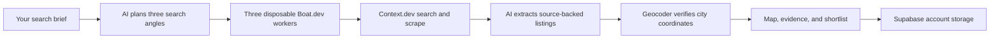

<div align="center">

# 🦆 Duck.Sale

### Find your next questionable purchase. Privately, if necessary.

A fleet of little search boats. Real source links. A suspiciously large duck budget.

**[Try Duck.Sale](https://duck.sale)** · **[Watch the 3-minute demo](https://youtu.be/XXRGiBiYMJ0)** · **[Open Private Mode](https://duck.sale/private)** · **[Download the deck](https://duck.sale/demo/duck-sale-deck.pptx)**


</div>

## Ahoy, judges 👋

**You do not need to install anything or bring API keys to inspect the product.** Open [duck.sale](https://duck.sale) and click **Watch 20-boat voyage**. It replays real listing snapshots across the coasts and inland lakes. The movement is simulated, the replay is labeled, and it makes no paid API calls.

For a **fresh search**, sign in on the website or request a temporary hosted-access token from the maintainer. Fresh searches use paid services and can return partial results. No token is published in this repository.

Duck.Sale finds boats, GPUs and AI computers, Pokémon boxes, giant inflatable ducks—or whatever oddly specific thing you type. It collects prices, photos, locations, and original links, then makes the search process visible instead of asking you to trust a spinner.

> **What is real?** Live voyages use actual provider requests. The radio panel records calls, timings, and failures. Missing facts stay unknown. Generated pictures are labeled illustrations, never passed off as seller photos.

## Find your way around

- [Why this build stands out](#why-this-build-stands-out)
- [A 60-second judge walkthrough](#a-60-second-judge-walkthrough)
- [How the boats work](#how-the-boats-work)
- [What each tool actually does](#what-each-tool-actually-does)
- [Private Mode, plainly explained](#private-mode-plainly-explained)
- [Choose your setup](#choose-your-setup)
- [A. Run the replay locally—no keys](#a-run-the-replay-locallyno-keys)
- [B. Use our hosted backend—one token](#b-use-our-hosted-backendone-token)
- [C. Self-host live searches](#c-self-host-live-searches)
- [Requirements and environment variables](#requirements-and-environment-variables)
- [Deploy your own copy](#deploy-your-own-copy)
- [Troubleshooting](#troubleshooting)
- [What works, what is limited](#what-works-what-is-limited)
- [Code map and verification](#code-map-and-verification)

## Why this build stands out

1. **Useful beyond the boat joke.** One brief searches across sources and categories, with specialist and local search angles.
2. **You can inspect the work.** Select a boat to see its actual provider calls. Open a listing to inspect source evidence. Errors and partial coverage remain visible.
3. **Privacy has a concrete data flow.** Private Mode separates an approved public query from a private ranking brief, verifies the confidential gateway connection, and checks worker VPN egress.
4. **The interface teaches the system.** Boats, routes, treasure pins, and the radio panel explain parallel discovery without hiding uncertainty.
5. **The ducks have brakes.** Bounded worker lifetimes, transactional admission limits, a shared Context request queue, and explicit cleanup help contain spending and failures.

These are reasons to consider the build, not claims that it has won a prize. [Hackathon requirements and evidence](docs/HACKATHON.md) remain separate from product claims. Built with AI-agent assistance under human direction.

## A 60-second judge walkthrough

| Time | What to do | What it demonstrates |
|---|---|---|
| 0–15s | Open the site and start **Watch 20-boat voyage** | Source snapshots, geographic pins, clearly labeled replay |
| 15–30s | Open a treasure pin and its original source | Prices/photos with provenance, approximate city locations |
| 30–45s | Open **Private Mode** | Public-query approval, separate private brief, service manifest |
| 45–60s | Watch the [demo](https://youtu.be/XXRGiBiYMJ0), or inspect this README’s source links | Real live-search receipts, partial failures, labeled generated imagery |

A fresh live search can take a few minutes. The edited demo shortens waiting; the app does not fake progress to match it.

## How the boats work



The AI can suggest a location interpretation, but a geocoder supplies the displayed coordinates. Source evidence is checked before retaining prices, availability statements, images, and attributes. Listings are leads—not independent seller verification.

## What each tool actually does

| Tool | Actual integration | Where to inspect it |
|---|---|---|
| **Boat.dev** | Creates isolated search sandboxes, executes a fixed worker program, and stops/deletes workers | [Worker lifecycle](lib/server/boat.ts) |
| **Context.dev** | Searches the web and reads source pages inside the workers | [Worker program](lib/server/worker-source.ts) |
| **Vercel AI Gateway** | Standard-mode planning, structured extraction, location normalization, optional image generation | [AI pipeline](lib/server/ai.ts), [illustrations](lib/server/illustrations.ts) |
| **OpenAI directly** | Optional alternative to Gateway for standard-mode text and images, using your OpenAI key | [Model selection](lib/server/models.ts) |
| **NY Token Exchange / TrustedRouter** | Private Mode’s confidential-only inference, with gateway attestation and TLS binding checks | [Private inference](lib/server/private/inference.ts), [transport](lib/server/private/transport.ts) |
| **Mullvad / WireGuard** | Private workers use an isolated network namespace and a checked VPN exit; no direct-network fallback | [VPN launcher](lib/server/private/vpn-source.ts) |
| **Supabase** | Login, account-isolated standard searches and saved finds, generation records, and admission limits | [Migrations](supabase/migrations), [server auth](lib/server/db.ts) |
| **Next.js + Vercel** | UI, server routes, streaming updates, hosting, and environment configuration | [App](app), [deployment config](vercel.json) |
| **Open-Meteo / GeoNames** | City-level coordinates, not guessed seller addresses | [Geocoding](lib/server/geocode.ts) |
| **Teamily** | Hackathon coordination/source of event requirements; no Teamily API integration claimed | [Event notes](docs/HACKATHON.md) |

## Private Mode, plainly explained


Imagine buying a surprise giant duck. The internet needs to know **“giant inflatable duck for sale.”** It does not need the birthday plan or your real budget.

1. **You approve the public query.** Only those search terms go to Boat/Context for discovery.
2. **You enter your private preferences separately.** The app processes them in server memory and sends them to NYTE/TrustedRouter with confidential routing required.
3. **The worker uses a VPN.** Its exit is checked before discovery. If the required confidential route or VPN is unavailable, the private request stops rather than switching to an ordinary route.
4. **You get a privacy receipt.** The response reports VPN verification, worker cleanup, and content-storage behavior.

**What is not saved:** the private brief, approved query, retrieved content, and results are not written to Duck.Sale’s search history. **What remains:** account/timing metadata for admission and rate limits. The browser clears page content on departure or after 15 minutes.

**Honest boundary:** this is not zero trace or browser-to-enclave encryption. The hosted app sees the brief in memory; providers receive the approved public query and requested pages; infrastructure metadata may remain. Context’s remote crawlers do not inherit the worker VPN. Photos do not load automatically in Private Mode. [Full privacy design and dated verification](docs/PRIVATE-MODE.md).

## Choose your setup

| You want to… | Provider keys needed? | Database needed? | Start here |
|---|---|---|---|
| Inspect the hosted replay and UI | No | No | [duck.sale](https://duck.sale) |
| Run the UI and recorded replay locally | No | No | A below |
| Ask our backend to do a fresh search | No provider keys; one temporary access token | No local database | B below |
| Run your own live-search installation | Boat + Context + Gateway **or** OpenAI | Your own Supabase project | C below |
| Self-host Private Mode | Above, plus TrustedRouter and WireGuard | Your own Supabase project | C + [private setup](docs/PRIVATE-MODE.md) |

**An OpenAI key replaces the standard AI provider, not Boat, Context, or Supabase.** It does not turn ordinary OpenAI inference into confidential inference.

## A. Run the replay locally—no keys

### You need

- Git
- **Node.js 22 or newer** and npm (`node --version` / `npm --version`)
- A browser
- Repository access if the repository is still private

```bash
git clone https://github.com/jacobwell/Duck.Sale.git
cd Duck.Sale
npm ci
npm run dev
```

Open **http://localhost:3000**, then click **Watch 20-boat voyage**. No `.env` file is required for the recorded replay. Fresh searches, login, saved finds, and Private Mode need configured services.

Already using port 3000? Stop here and manage your existing server yourself. This project does not need a second development server or port 3001.

## B. Use our hosted backend—one token

This is the **API/terminal path**: your local client calls our server, and our server manages the provider calls. For the full UI, use [duck.sale](https://duck.sale).

Ask the maintainer for a temporary `client.env` file, then save it as **`.env.hosted.local`** in this checkout. It contains:

```dotenv
DUCK_SALE_BACKEND_URL=https://duck.sale
DUCK_SALE_HOSTED_TOKEN=PASTE_THE_ISSUED_TOKEN_HERE
```

Check access without spending search credits:

```bash
npm run search:hosted -- --check
```

Run a fresh search:

```bash
npm run search:hosted -- "Catalina 30 sailboat for sale California"
```

The command streams real search events as newline-delimited JSON. Do not expect an instant complete result. Authentication, provider quotas, and the app’s search limits still apply.

**No provider keys are shared. No arbitrary token is accepted.** The issued token is random, expires, and only grants the dedicated demo search endpoints. It cannot read history or saved finds. Keep it out of screenshots, commits, and public README files. [Hosted/private API examples, issuance, limits, and revocation](docs/HOSTED-ACCESS.md).

## C. Self-host live searches

### 1. Install and copy the example

Follow A’s clone/install steps, then:

```bash
cp .env.example .env.local
```

Fill `.env.local` locally. Never commit it. Do not put server secrets in variables beginning `NEXT_PUBLIC_`.

### 2. Create your own Supabase project

Copy its project URL and public anon/publishable key into the two `NEXT_PUBLIC_SUPABASE_*` variables. Put the service-role/secret key in `SUPABASE_SERVICE_ROLE_KEY` **on the server only**. Set `POSTGRES_URL_NON_POOLING` to your project’s direct or session-pooler PostgreSQL connection string for migrations.

```bash
node --env-file=.env.local scripts/migrate.mjs
```

The runner verifies database TLS, tracks completed migrations, and applies changes in a transaction. If the connection fails, confirm your credentials and connection mode; do not disable certificate checking.

In **Supabase → Authentication → URL Configuration**, set your Site URL and allow:

- `http://localhost:3000/**` for local development
- `https://YOUR-DOMAIN/**` for your deployment

Enable email login. Supabase’s default email service has recipient restrictions; configure SMTP for general public signups. The original hosted project can be opened through **Vercel → Storage → Supabase → Open in Supabase**; a fork should use its own project.

### 3. Add Boat and Context keys

Set `BOAT_API_KEY` and `CONTEXT_DEV_API_KEY`. These must belong to accounts with working access/credits. Local workers also need a publicly reachable permit endpoint: set `DUCK_SALE_APP_URL` to **your own deployed copy** with the same database and server key. Do not point a separately configured database at our production permit endpoint.

### 4. Pick one standard AI provider

**Option 1 — Vercel AI Gateway (default):**

```dotenv
AI_PROVIDER=gateway
AI_GATEWAY_API_KEY=YOUR_GATEWAY_KEY
```

On Vercel, project OIDC can supply Gateway authentication instead. For local runs, a Gateway API key is the simplest setup.

**Option 2 — Your OpenAI key, called directly:**

```dotenv
AI_PROVIDER=openai
OPENAI_API_KEY=YOUR_OPENAI_KEY
OPENAI_MODEL=gpt-6.2-sol
OPENAI_IMAGE_MODEL=gpt-image-2.6-flare
```

Choose models available to your account. Text models must support structured output. The radio and service setup panel identify **OpenAI** when that route is selected; private inference still uses NYTE. Image generation is optional and billed separately.

### 5. Run it

```bash
npm run dev
```

Open localhost:3000 → **Service setup** → check that services are configured → sign in → send a small search. “Configured” means credentials are present, not that provider credits or every request have been verified.

For Private Mode, also configure `TRUSTEDROUTER_API_KEY` and `DUCK_SALE_PRIVATE_VPN_JSON`. The latter is a complete dedicated WireGuard profile—not a VPN subscription name. [Required profile fields and privacy behavior](docs/PRIVATE-MODE.md).

## Requirements and environment variables

Blank values and comments are in [`.env.example`](.env.example).

| Variable | Needed for | Secret? |
|---|---|---|
| `BOAT_API_KEY` | Live worker creation | Yes |
| `CONTEXT_DEV_API_KEY` | Live web search/scraping | Yes |
| `NEXT_PUBLIC_SUPABASE_URL` | Login and account storage | No |
| `NEXT_PUBLIC_SUPABASE_ANON_KEY` | Public Supabase client, protected by RLS | No; never substitute the service key |
| `SUPABASE_SERVICE_ROLE_KEY` | Server-side storage and admission | **Yes, server only** |
| `POSTGRES_URL_NON_POOLING` | Apply migrations | **Yes** |
| `AI_PROVIDER` | `gateway` (default) or `openai` | No |
| `AI_GATEWAY_API_KEY` | Gateway outside Vercel OIDC | Yes |
| `OPENAI_API_KEY` | Direct OpenAI mode | Yes |
| `OPENAI_MODEL` / `OPENAI_IMAGE_MODEL` | Direct OpenAI model overrides | No |
| `AI_MODEL` / `AI_IMAGE_MODEL` | Gateway model overrides | No |
| `DUCK_SALE_APP_URL` | Public origin for your workers’ permit callback | No |
| `TRUSTEDROUTER_API_KEY` | Private Mode confidential inference | Yes |
| `DUCK_SALE_PRIVATE_VPN_JSON` | Private Mode WireGuard profile | **Yes: includes a private key** |
| `DUCK_SALE_VISION` | Optional source-photo analysis; default `false` | No |
| `OPEN_METEO_API_KEY` | Licensed commercial geocoding, when applicable | Yes |
| `DUCK_SALE_BACKEND_URL` / `DUCK_SALE_HOSTED_TOKEN` | Hosted CLI only; no provider keys required | Token is secret |
| `DUCK_SALE_DEMO_ACCESS` | Server-only opt-in hosted-access configuration | Sensitive capability configuration |

## Deploy your own copy

1. Import your fork into Vercel as a Next.js project.
2. Add your environment variables to the correct deployment environment.
3. Apply Supabase migrations and configure login redirects.
4. Set `DUCK_SALE_APP_URL` to your public deployment origin, reachable by Boat workers.
5. Deploy, then inspect `/api/config` and the UI’s **Service setup** panel.
6. Try a small authenticated search; inspect receipts and partial failures.

The worker callback needs to be reachable without Vercel’s preview-login wall. Prefer your production custom domain for a normal installation. Never expose the service-role key to solve callback access.

Already using the original checkout? Its `.vercel` directory is ignored. A clone must be linked to your own project; it does not inherit our hosting account or keys. `vercel env pull` overwrites its output file—pull to a separate file and merge deliberately.

## Troubleshooting

| Symptom | First thing to check |
|---|---|
| “Repository not found” | GitHub access; this repo may still be private |
| Replay works, but live search is unavailable | Expected with no keys; inspect Service setup |
| Hosted access returns 401 | Token missing, wrong, expired, or not enabled on the selected server |
| Hosted access works but history is denied | Expected: demo capabilities do not grant history access |
| Email link never arrives | Supabase email restrictions/SMTP and allowed redirect URLs |
| Database migration fails | Correct project connection string, password escaping, network access, and CA verification |
| Workers wait or fail to acquire permits | `DUCK_SALE_APP_URL` must reach your own matching server/database |
| Context returns 429 | Provider rate limits/credits; the queue backs off and preserves partial results |
| Standard AI fails | Match `AI_PROVIDER` to the key and model your account can use |
| Private Mode is docked | NYTE and the complete WireGuard profile are additional requirements |
| No source photo | The source may have none; optional generated illustrations are labeled |
| A listing is unplaced | Location could not be resolved confidently; no invented seller address |

## What works, what is limited

- **Live:** parallel discovery, source receipts, city pins, continuation, account history, shortlist, and optional labeled illustrations.
- **Private:** separate approved query/private brief, confidential gateway verification, VPN worker checks, bounded cleanup, and no saved private search content.
- **Without keys:** the UI and recorded 20-boat replay. This is not a free live-search engine.
- **Limits:** five searches per account per hour, one active search per account, and 30 across the fleet per hour. Private voyages additionally serialize access to the dedicated VPN identity.
- **Coverage:** searches can be partial or empty. Prices, seller identity, inventory, condition, and shipping still require confirmation with the source.
- **Persistence:** standard mode stores searches and evidence; Private Mode retains only admission metadata. “Estimated cost unavailable” is not “free.”
- **Not implemented:** seller outreach, buying, price alerts, authenticated marketplace crawling, or a promise of exhaustive coverage.
- **Geocoding:** the free endpoint is for noncommercial use; commercial deployments need the appropriate license.

## Code map and verification

| Start here | Purpose |
|---|---|
| [`components/workspace.tsx`](components/workspace.tsx) | Main UI and real search events |
| [`components/fleet-map.tsx`](components/fleet-map.tsx) | Map, boats, pins, API radio |
| [`components/private-workspace.tsx`](components/private-workspace.tsx) | Private query approval and receipt UI |
| [`lib/server/search.ts`](lib/server/search.ts) | Search orchestration and partial results |
| [`lib/server/models.ts`](lib/server/models.ts) | Gateway/OpenAI selection |
| [`lib/server/private/`](lib/server/private/) | Confidential transport and VPN |
| [`lib/server/demo-access.ts`](lib/server/demo-access.ts) | Expiring hosted capability verification |
| [`scripts/hosted-search.mjs`](scripts/hosted-search.mjs) | One-token hosted client |
| [`supabase/migrations/`](supabase/migrations/) | RLS, account isolation, transactional limits |

```bash
npm run lint
npm run typecheck
npm run build:check
```

`build:check` uses `.next-build`, leaving your development output alone. No unit tests were requested or added. Paid live-search smoke scripts are explicit opt-in operations, not part of the build.

See [verification history](docs/VERIFICATION.md), [private verification](docs/PRIVATE-MODE.md), [operations details](docs/OPERATIONS.md), and [hosted access](docs/HOSTED-ACCESS.md). The new provider selection passes lint, TypeScript, and a production build. Direct OpenAI calls have **not** been exercised with a real OpenAI key; select models enabled for your account. Hosted capability checks cover scope, wrong methods, invalid tokens, and expiry. No mock response is presented as a live provider result.

Legacy database/bucket identifiers and `BOATDUCK_*` environment fallbacks remain to preserve existing installations. The product name is **Duck.Sale**.

---

**No judgment. Just ducks.**
